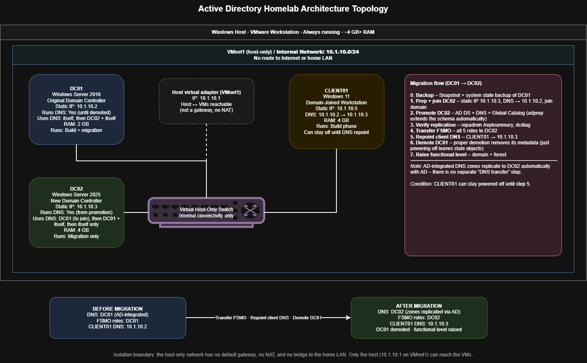
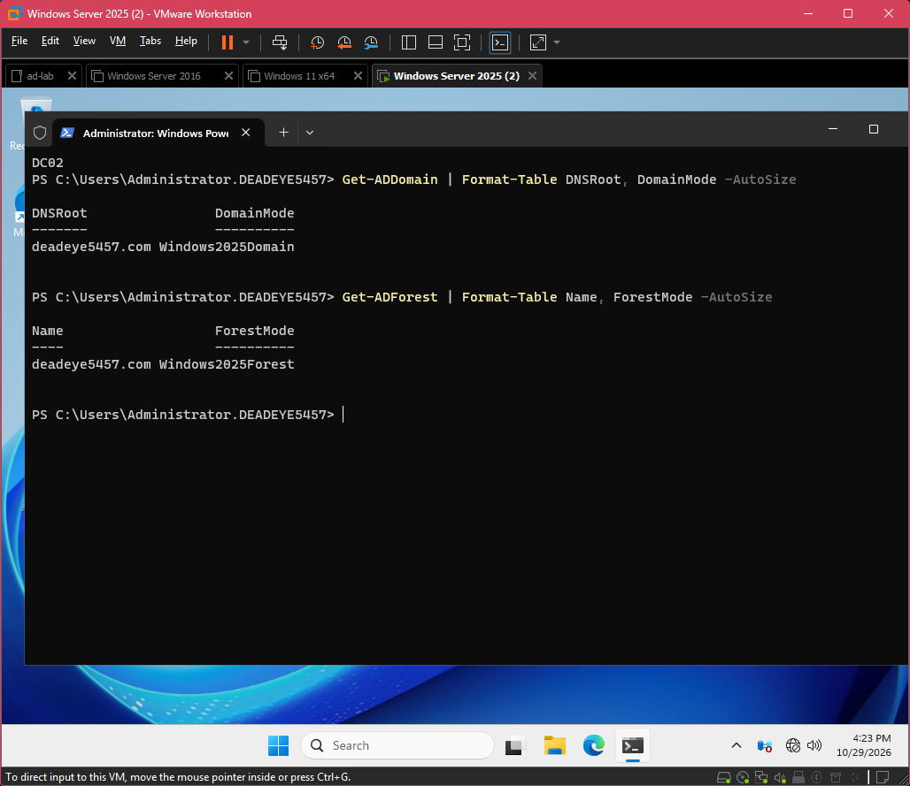
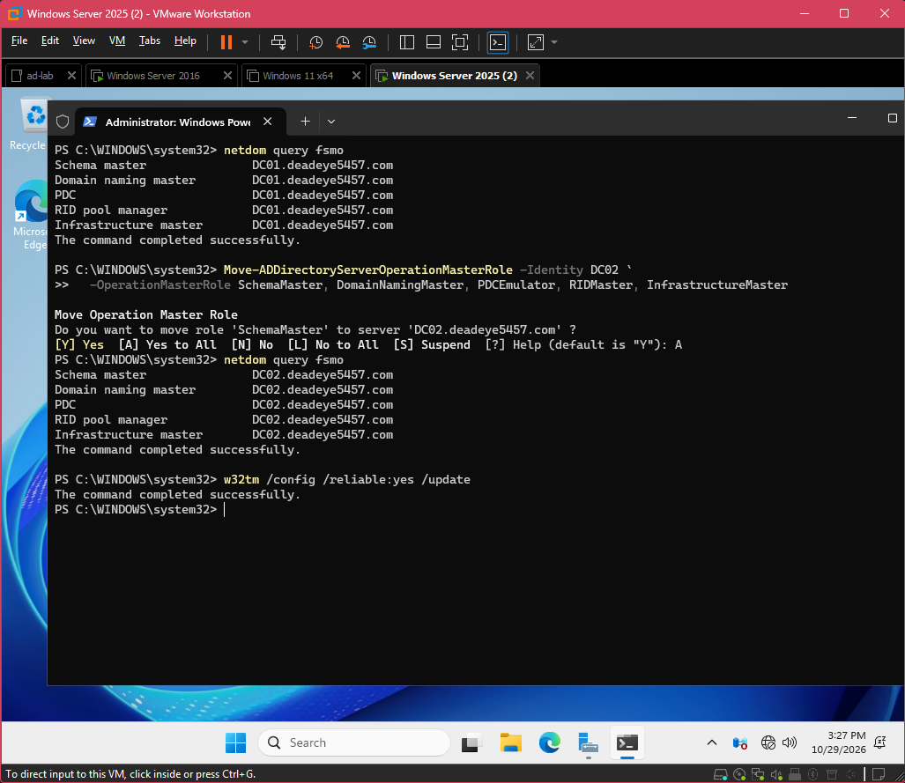

# AD Lab: Scripted Build + Server 2016 to 2025 Migration

An Active Directory domain built from PowerShell scripts, then migrated side by side from Windows Server 2016 to Windows Server 2025. The migration covered the schema extension, replication checks, the transfer of all five FSMO roles, a "scream test" with the old DC switched off, a clean demotion, and the functional-level raise.

Every claim below links to a screenshot or transcript. The [troubleshooting log](TROUBLESHOOTING.md) covers the 11 problems I hit along the way, including a DC crashing mid-migration, and how I proved each fix.



## At a glance

| | |
|---|---|
| **Host** | Windows laptop, 16 GB RAM, VMware Workstation |
| **Network** | `10.1.10.0/24`, host-only (VMnet1), no gateway, no internet |
| **Domain** | `deadeye5457.com` |
| **DC01** | Server 2016, `10.1.10.2`. Original DC, built by script, demoted at the end |
| **DC02** | Server 2025, `10.1.10.3`. Migration target, now the only DC |
| **CLIENT01** | Windows 11, `10.1.10.5`. Domain-joined workstation |
| **Result** | Schema 87 to 91, domain and forest at `Windows2025`, DC01 cleanly removed |



## What's in here

```
scripts/
  00-prep.ps1            static IP, DNS, rename + reboot (runs on every fresh VM)
  01-install-adds.ps1    creates the forest at 2016 functional level
  02-ou-structure.ps1    HR, IT, Consultants, Groups OUs (safe to re-run)
  03-users-groups.ps1    users from data/users.csv, security groups + membership
  04-gpos.ps1            Task Manager restriction GPO, linked to HR
  05-shares.ps1          HR and Personal shares, NTFS scoped to their groups
  data/users.csv         the domain's users, kept as data rather than code
  gpo-backups/           Default Domain Policy (password + lockout) backup
evidence/                numbered screenshots + PowerShell transcripts
diagrams/                topology (draw.io source + PNG)
TROUBLESHOOTING.md       every problem, root cause, fix, and proof
```

## Part 1: The scripted build

The domain is defined in text files, not inside a VM. Delete every VM and the same domain comes back from this repo.

| Step | Proof |
|---|---|
| Forest created by script at 2016 functional level, schema 87 | [01-forest-created](evidence/01-forest-created.png) |
| OUs, users, groups and GPOs created by the scripts | [02-domain-populated](evidence/02-domain-populated.png) |
| Password and lockout policy (the one manual GPO step) in effect | [02b-password-policy](evidence/02b-password-policy.png) |
| Client joined, HR GPO applied (Task Manager disabled) | [03-client-joined](evidence/03-client-joined.png) |

**Scripted vs manual.** Settings stored in the registry, like the Task Manager restriction, script cleanly with `Set-GPRegistryValue`. Password and lockout policy have no equivalent cmdlet, so the standard approach is to configure them once in GPMC, back them up with `Backup-GPO`, commit the backup, and restore it with `Import-GPO`. That backup is in `scripts/gpo-backups/`.

## Part 2: The side-by-side migration

The migration was done side by side rather than as an in-place upgrade. Each step had a check that had to pass before the next one started.

| # | Step | Proof |
|---|---|---|
| 1 | DC02 finds the domain's DCs through DNS (SRV lookup) before joining | [04-srv-lookup](evidence/04-srv-lookup.png) |
| 2 | System state backup of DC01 to a separate disk: the rollback plan | [05-systemstate-backup](evidence/05-systemstate-backup.png) |
| 3 | DC02 promoted. Adprep extended the schema automatically | [transcripts](evidence/transcripts/) |
| 4 | Replication healthy in **both** directions, 0 failures | [06-replsummary](evidence/06-replsummary.png) |
| 5 | Core dcdiag tests passing on both DCs (VM noise triaged, see [log #8](TROUBLESHOOTING.md#8-dcdiag-wall-of-red-after-promoting-dc02)) | [07-dcdiag-core](evidence/07-dcdiag-core.png) |
| 6 | SYSVOL shared on DC02 and initial sync complete (event 4604) | [07a-sysvol](evidence/07a-sysvol.png) |
| 7 | Schema `objectVersion` went from 87 to **91** | [08-schema-version](evidence/08-schema-version.png) |
| 8 | All five FSMO roles moved from DC01 to DC02 | [09-fsmo-before-and-after](evidence/09-fsmo-before-and-after.png) |
| 9 | Scream test: DC01 powered off, client logs on and gets GPO from DC02 | [10-client-on-dc02](evidence/10-client-on-dc02.png) |
| 10 | DC01 demoted cleanly; one DC left and no stale NS records | [11-only-dc02](evidence/11-only-dc02.png) |
| 11 | Domain and forest raised to `Windows2025` (one-way) | [12-funclevel-raised](evidence/12-funclevel-raised.png) |
| 12 | Snapshots taken in coordinated pairs at every risky step | [13-snapshot-tree](evidence/13-snapshot-tree.png) |



**Why snapshots were taken in pairs.** Once two DCs are replicating, reverting only one of them to an older snapshot causes a USN rollback, which silently breaks replication. From DC02's promotion onward, both DCs were shut down and snapshotted together, and would only ever have been reverted together.

## Troubleshooting highlights

The full log is in [TROUBLESHOOTING.md](TROUBLESHOOTING.md). Three entries:

- **DC02 blue-screened mid-migration (`0x7A`).** I decoded the bugcheck parameters first (`c0000185` = I/O device error), which pointed at the host's storage rather than Windows. The VMs live on an external SSD over USB, and it had dropped out for a moment. I fixed the USB power management, then checked the AD database for corruption before continuing.
- **`dcdiag` reported a wall of failures after promotion.** I sorted every one into VM noise or a real problem, fixed the two real ones (replication lag, a firewall rule), and proved the fixes with `repadmin`, the SYSVOL state and event 4604 before moving any roles.
- **A clean demotion still left stale DNS.** The `_msdcs` delegation still pointed at DC01, because it was never updated when DC02 was promoted. I found it with a post-demotion NS check and fixed it.

## Rebuild it

On a fresh Server 2016 VM, in elevated PowerShell with the repo's `scripts` folder copied to `C:\Lab\scripts`:

```powershell
Set-ExecutionPolicy -Scope Process -ExecutionPolicy Bypass -Force
Get-ChildItem C:\Lab\scripts -Recurse | Unblock-File
cd C:\Lab\scripts

.\00-prep.ps1 -ComputerName DC01 -IPAddress 10.1.10.2 -DnsServers 127.0.0.1   # reboots
.\01-install-adds.ps1                                                          # prompts for DSRM password, reboots
.\02-ou-structure.ps1
.\03-users-groups.ps1
.\04-gpos.ps1
.\05-shares.ps1
Import-GPO -BackupGpoName 'Default Domain Policy' -TargetName 'Default Domain Policy' -Path C:\Lab\scripts\gpo-backups
```

The two reboots mean this is a run order, not a single command. Scripts 02 to 05 check before creating anything, so running them twice is safe.

## What I learned

- **PowerShell can do almost everything I used to click through.** Promoting and demoting DCs, creating users and groups, linking GPOs, setting share and NTFS permissions: each one is a few lines, it's repeatable, and it leaves a transcript behind as proof.
- **Side by side is slower than in place, and much safer.** The old DC stays up as a fallback until the new one has proven itself through replication checks, a role transfer and a scream test. It also exposed mistakes I'd otherwise have missed. I built a Task Manager GPO by hand without noticing the script had already made one, which left two GPOs doing the same job on the HR OU until a link check caught it.
- **Elevation matters on clients.** Some commands, like `gpupdate`, run fine as a standard user, but my prep script failed because it changes machine-level settings (static IP, computer name), and those need an elevated session. I also learned that with the only DNS server down, even the domain admin account can't elevate on a client, because there's no DC to check the password against.
- **Verify before every irreversible step, and keep a way back.** I didn't move roles until replication was proven, didn't demote until the scream test passed, and didn't raise the functional level until the new DC had come through a crash. When DC02 blue-screened because my USB SSD dropped out, the system state backup and the coordinated snapshots meant that a bad outcome would have cost me minutes, not the whole lab.

## Limitations and next steps

- The Default Domain Policy restore (`Import-GPO`) is committed but hasn't been re-tested on a fresh build yet.
- The build is a run order across two reboots. A next version could resume automatically after each reboot.
- **Next project:** a deliberately vulnerable copy of this domain, built from the `build-complete` snapshot on its own isolated network. It covers Kerberoasting, AS-REP roasting and BloodHound attack paths from a Kali VM, then the hardening (including LAPS), then re-running each attack to prove it now fails.

**Skills:** Active Directory Domain Services, DNS (SRV, delegation, reverse zones), Group Policy, FSMO roles, replication (`repadmin`, `dcdiag`, DFSR/SYSVOL), Windows Server Backup, PowerShell automation, VMware Workstation, Git.
